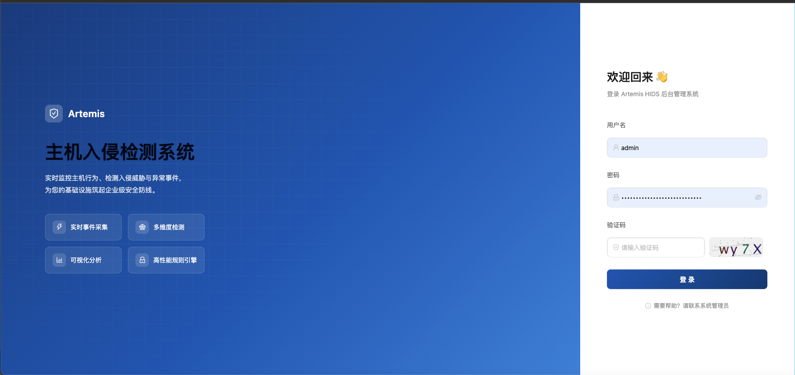
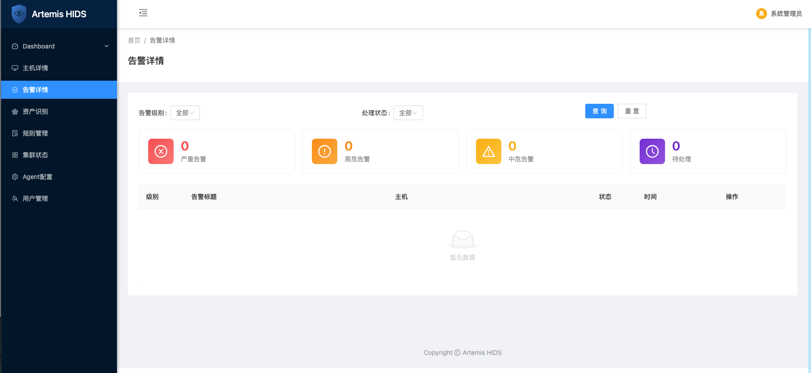

# Artemis HIDS

Artemis 是一套面向 Linux 主机的入侵检测系统（HIDS），采用 Agent 上报 + 流式管道处理 + 规则引擎告警的架构。Agent 部署在被保护主机上，采集文件、进程、网络、系统日志等安全事件，经 gRPC 上报至服务端，通过 Kafka 广播给下游的规则引擎与数据落地组件，并提供 Web 管理后台进行统一运维、规则配置、资产识别与告警查看。

## 界面预览

<table>
  <tr>
    <td></td>
    <td></td>
  </tr>
  <tr>
    <td align="center">登录页</td>
    <td align="center">Web 管理后台 - 告警详情</td>
  </tr>
</table>

## 功能

- **主机侵入检测**：文件变更监控、进程执行监控、网络连接监控、系统安全日志监控、系统信息采集，覆盖主机侧核心安全事件面。
- **高性能事件管道**：Agent gRPC Kafka 的异步事件流，支撑大规模主机集群的实时事件采集与分发。
- **规则引擎与告警**：基于 MongoDB 存储的规则集做实时匹配（支持轮询热更新，改规则不用重启进程），命中后可输出到标准输出、本地文件、Kafka 告警主题等多个目的地。
- **资产识别**：端口、软件包、容器、进程等主机资产数据定期从 OpenObserve 同步落地到 MongoDB，供 Web 后台跨主机聚合查询。
- **事件归档**：事件与告警数据同步落地到 MongoDB，支持历史查询与审计。
- **Web 管理后台**：Agent 管理（含单个/批量升级、卸载、配置热更新）、规则配置、资产识别、告警查看等操作界面，前后端分离。
- **Agent 全生命周期管理**：Agent 自身支持多 worker 进程编排、资源限额、TLS 双向认证，并支持通过 manager 远程下发配置更新、二进制自升级（含各 Worker 独立升级）与远程卸载。
- **一键部署**：Docker Compose 编排全部组件，首次启动自动生成随机凭证（Mongo/Redis/Kafka/OpenObserve），无需手动配置明文*。

## 架构

```
                     ┌─────────────┐
 被保护主机 ------> │ Agent (Go) │ file / network / exec / log / system 多 worker
                     └──────┬──────┘
                            │ gRPC (TLS)，心跳同时携带 manager 下发的命令
                            ▼
                     ┌─────────────┐
                     │ server_rust │  gRPC 接入层，事件转发 + 命令下发中转（经 Redis）
                     └──────┬──────┘
                            │ 写入
                            ▼
                     ┌─────────────┐
                     │   Kafka     │  (Redpanda，SASL/SCRAM 认证)
                     │ (Redpanda)  │
                     └──┬───────┬──┘
                         │       │
             消费事件     │       │  消费/写出告警
                         ▼       ▼
                 ┌───────────┐ ┌──────────────┐
                 │ connector │ │ rule-enginx  │  规则匹配（规则存于 MongoDB，
                 │ (Rust)    │ │ (Rust)       │  轮询热更新）+ 告警输出
                 └─────┬─────┘ └──────┬───────┘  (stdout/file/kafka)
                       │              │
                       ▼              │
              ┌─────────────────┐     │
              │  OpenObserve     │    │
              │ (可观测性/检索)  │    │
              └────────┬────────┘     │
                       │ 定时轮询查询   │
                       ▼              │
              ┌───────────────┐             系统信息/告警/端口/软件/容器/进程
              │ mongo_syncer  │             同步落库（快照型 delete-then-insert，
              │ (Go)          │             流水型按游标增量 upsert）
              └──────┬────────┘
                     │
                     ▼
              ┌─────────────┐   ◄───────────── rule-enginx 轮询读取规则集
              │  MongoDB    │ (Percona Server for MongoDB)
              └─────────────┘

              ┌─────────┐        ┌──────────────────┐
              │ manager │<------ │ frontend (nginx)  │  Web 管理后台 + Agent 下载
              │  (Go)   │  REST  │  :80 前端/API      │  Agent/规则/资产/告警管理
              └────┬────┘        │  :8081 Agent 下载  │
                   │             └──────────────────┘
                   ▼
              MongoDB / Redis（含 Agent 命令队列）
```

**组件说明：**

| 组件 | 语言 | 职责 |
|---|---|---|
| `agent` | Go | 部署在被保护主机上，多 worker 采集文件/网络/进程/日志/系统信息，经 TLS gRPC 上报事件与心跳；接收并执行 manager 下发的配置更新/自升级/卸载命令 |
| `server_rust` | Rust | gRPC 服务端，接收 Agent 上报事件并写入 Kafka；心跳时从 Redis 取出待执行命令随响应下发给 Agent，并接收 Agent 回传的命令执行结果 |
| `connector` | Rust | 消费 Kafka 事件，写入 OpenObserve 用于检索与可视化 |
| `rule-enginx_rust` | Rust | 从 MongoDB 加载规则集（定时轮询热更新，无需重启），基于规则做实时告警匹配，输出到 stdout/文件/Kafka 告警主题 |
| `mongo_syncer` | Go | 定时轮询查询 OpenObserve，把系统信息/告警/端口/软件/容器/进程等数据同步落地到 MongoDB |
| `manager` | Go | Web 管理后台的 REST API 服务，管理 Agent（含命令下发）、规则、资产、告警、用户等 |
| `frontend` | Vue + Nginx | 管理后台前端页面，Nginx 反代 `/api/` 到 manager，并独立开一个端口提供 Agent 安装包下载 |
| `kafka`（Redpanda） | - | 事件总线，SASL/SCRAM-SHA-256 认证 |
| `mongodb`（Percona Server for MongoDB） | - | 规则、事件、告警、资产数据持久化存储 |
| `redis` | - | manager 缓存/会话、Agent 命令队列等 |
| `openobserve` | - | 日志与事件的可观测性检索平台，也是 mongo_syncer 落库前的数据源 |

## 技术栈

- **Agent**：Go 1.25，gRPC/TLS，fanotify/netlink/audit 等 Linux 内核接口，systemd 服务托管
- **接入层 / 流处理**：Rust（server_rust / connector / rule-enginx_rust），Tokio 异步运行时，Tonic (gRPC)，rdkafka，MongoDB 官方驱动（规则热加载）
- **管理后台**：Go（manager，Gin + JWT），Vue 2 + Ant Design Vue（frontend）
- **数据同步**：Go（mongo_syncer），HTTP 客户端轮询 OpenObserve `_search` API + MongoDB 官方驱动
- **消息队列**：Redpanda（Kafka API 兼容），SASL/SCRAM-SHA-256 认证
- **数据库/缓存**：Percona Server for MongoDB、Redis 5
- **可观测性**：OpenObserve
- **部署**：Docker / docker-compose，Nginx 反向代理，envsubst 配置模板渲染

## 使用方法

### 环境要求

- Docker、docker-compose
- 目标主机需要 root 权限以安装 Agent（涉及内核审计/网络监控接口）

### 一键部署

```bash
git clone <repo-url> && cd Artemis_HIDS

# 首次运行会自动生成随机凭证（Mongo/Redis/Kafka/OpenObserve）写入 .env，
# 并依次构建 agent-builder（产出 Agent 安装包）与其余所有服务镜像
./build.sh

# 启动全部服务
docker-compose up -d

# 查看日志
docker-compose logs -f <service>

# 停止服务
docker-compose down
```

构建完成后访问：

- Web 管理后台：`http://<host>/`（Nginx :80，反代 API 到 manager）
- Agent 安装包下载：`http://<host>:8081/artemis-agent.tar.gz`

首次生成的随机凭证会打印在 `./build.sh` 执行日志中，也可在生成的 `.env` 文件中查看。

### 部署 Agent

在需要采集事件的主机上，支持两种安装方式：

**方式一：一键 shell 安装（推荐）**

```bash
curl -sSL http://<host>:8081/install.sh | sudo ARTEMIS_SERVER=http://<host>:8081 bash
```

脚本会自动下载 `artemis-agent.tar.gz`、解压并调用其中的 `install.sh` 完成 systemd 服务安装。

**方式二：下载 tar 包手动安装**

```bash
curl -O http://<host>:8081/artemis-agent.tar.gz
tar -xzf artemis-agent.tar.gz
cd <解压目录>

# 安装为 systemd 服务
sudo ./install.sh

# 卸载
sudo ./uninstall.sh
```

两种方式安装前均需按 `config.example.json` 配置 Agent 连接的 `server_rust` 地址及 TLS 证书。

### 单独构建某个服务

```bash
docker-compose build <service_name> # 如 server_rust / connector / manager / frontend
```
